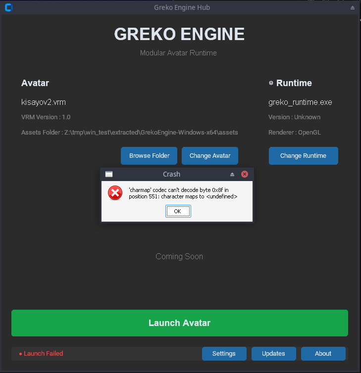
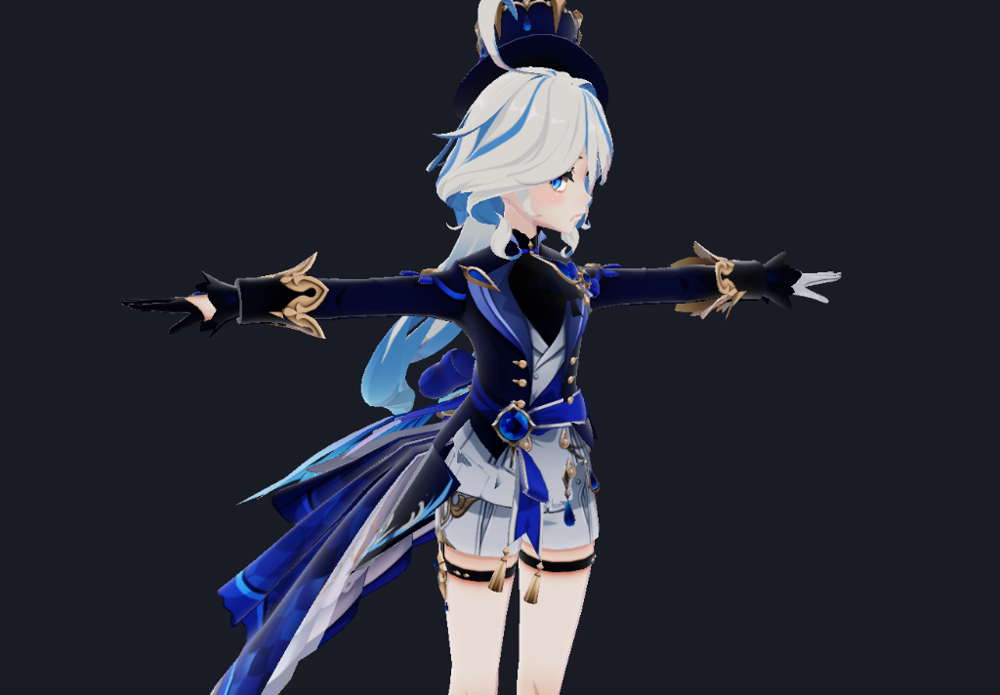
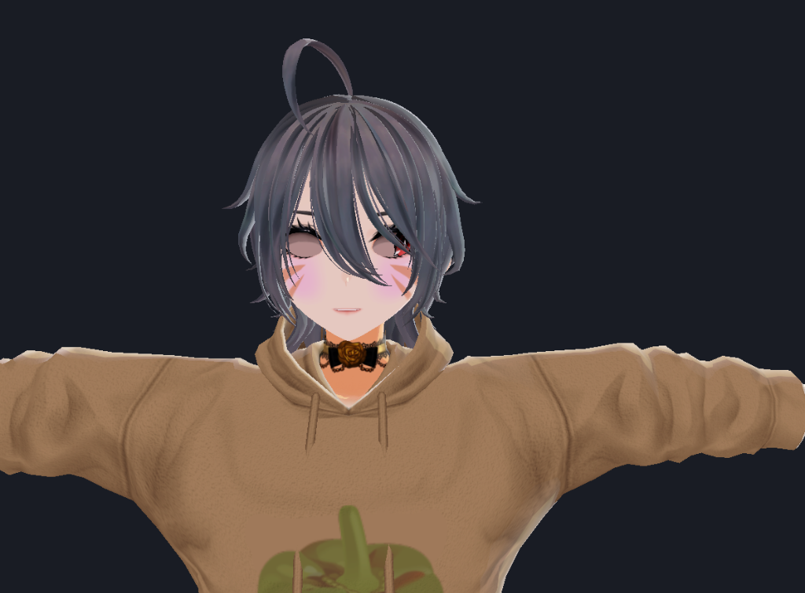

# 🚀 Greko Engine

<p align="center">
  
</p>

<p align="center">
  <strong>Next-Generation Modular 3D Avatar Runtime for VRM 0.0 & VRM 1.0</strong>
</p>

<p align="center">
  <a href="https://github.com/craterworldstudio/GrekoEngine/releases"></a>
  
  
  
  <a href="https://soulfirex.gumroad.com/l/grekoengine"></a>
</p>

---

## 📸 Showcase & UI Preview

<p align="center">
  
  <br />
  <em>The modern dark-themed Greko Engine Hub with automated avatar detection and runtime management.</em>
</p>

<p align="center">
  
  <br />
  <em>Real-time OpenGL rendering engine with Dear ImGui studio controls, dynamic lighting, and facial blendshape posing.</em>
</p>

<p align="center">
  
  <br />
  <em>High-fidelity Cel-Shading, outer rim lighting, soft shadow offsets, and animated humanoid bone constraints.</em>
</p>

---

## 🌟 Key Features

- **⚡ Hybrid High-Performance Architecture**:
  - **Python Brain**: Handles glTF/GLB structure parsing, phoneme timing sequences, and high-level behavioral logic.
  - **C++ OpenGL Muscle**: Pybind11 bridge feeding GPU buffers directly to an optimized OpenGL 4.3 Core Profile pipeline.
- **🎭 Complete VRM 0.0 & VRM 1.0 Support**:
  - Ingests VRoid Studio, UniGLTF, and custom VRM models natively.
  - Automatic fallback and normalization across different specification versions.
- **🧬 Hardware-Accelerated Morph Target Blitting**:
  - 10 active GPU morph slots with instantaneous delta blitting.
  - Smooth phoneme sequencing for lip sync (`REST`, `A`, `E`, `I`, `O`, `U`).
- **🌐 Dual-Language Japanese & English Expression Mapping**:
  - Automatically identifies Japanese expression targets (`まばたき`, `喜`, `口閉`, `あ`, `え`, `い`, `お`, `う`, `ウィンク`) and binds them to standard slots.
- **👀 Real-Time Procedural Behaviors**:
  - Autonomous dynamic blinking with adjustable rate and variance.
  - Procedural breathing animation with secondary chest/spine dynamics.
  - Eye Look-At targeting with yaw and pitch constraint limiting.
- **🎛️ Interactive In-Engine Studio Dock**:
  - Live Dear ImGui dock with Japanese font atlas support.
  - Fine-tune cel-shading smoothness, rim light color and intensity, ambient light, and shadow offsets in real-time.
  - Pose expressions manually with instant configuration saving.
- **📦 Zero-Dependency Standalone Releases**:
  - Standalone pre-compiled bundles available for both **Linux (x86_64)** and **Windows (x64)**.
  - No Python, pip, GCC, or Visual Studio installation required on end-user machines.

---

## 🎮 Navigation & Controls

| Input | Action |
| :--- | :--- |
| <kbd>W</kbd> / <kbd>A</kbd> / <kbd>S</kbd> / <kbd>D</kbd> | Move Camera Forward / Left / Backward / Right |
| <kbd>E</kbd> / <kbd>Q</kbd> | Ascend / Descend Camera (Fly Mode) |
| <kbd>Mouse</kbd> | Look Around (Yaw & Pitch) |
| <kbd>ESC</kbd> | Toggle Mouse Capture & Release Cursor for Studio Dock |

---

## 🚀 Quick Start (Standalone Binaries)

### 🐧 Linux (x86_64)
1. Download `GrekoEngine-Linux-x64.tar.gz` from the [Releases](https://github.com/craterworldstudio/GrekoEngine/releases) page.
2. Extract the archive:
   ```bash
   tar -xzf GrekoEngine-Linux-x64.tar.gz
   cd GrekoEngine-Linux-x64
   ```
3. Drop your `.vrm` avatars into the `assets/` folder.
4. Launch the application:
   ```bash
   ./launcher
   ```

### 🪟 Windows (x64)
1. Download `GrekoEngine-Windows-x64.zip` from the [Releases](https://github.com/craterworldstudio/GrekoEngine/releases) page.
2. Extract the zip file.
3. Place your `.vrm` models into the `assets/` directory.
4. Double-click `launcher.exe`.

---

## 💖 Thank You to Our Preview Testers!

> [!NOTE]
> **A heartfelt thank you** to everyone who has downloaded, run, and benchmarked the early preview builds! Your logs, bug reports, and feedback directly helped us track down complex cross-platform quirks (including Linux GLXFBConfig driver isolation, Wayland protocol scanning, and Windows UTF-8 charmap decoders).

If you encounter any glitches, visual rendering artifacts, or model parsing issues with your VRMs, please open a ticket on our [GitHub Issue Tracker](https://github.com/craterworldstudio/GrekoEngine/issues) with your log output.

---

## 🔮 Future Roadmap & Commercial Releases

Greko Engine is expanding into a comprehensive avatar companion and game engine runtime. Future builds will include:
- 🎙️ **Live Audio Microphone Lip Sync**: Real-time microphone input streaming directly into the phoneme blendshape sequencer.
- 🦴 **Full Physics & SpringBone Simulation**: GPU-accelerated secondary hair and clothing collision physics.
- 🕹️ **VMC & Motion Tracking Protocol**: Support for tracking data ingestion from OpenSeeFace, MediaPipe, and VRChat tracking software.
- 🎨 **PBR & Custom MToon Shaders**: Advanced cel-shading with subsurface scattering approximations.

> ### 💎 Support the Engine on Gumroad
> Future production-ready releases, extended feature sets, and commercial standalone tooling will be available for purchase at:
> 
> 👉 **[Get Greko Engine on Gumroad](https://soulfirex.gumroad.com/l/grekoengine)**
> 
> Purchasing the build helps directly fund dedicated GPU render farm testing, physics engine research, and continuous cross-platform maintenance.

---

## 📄 License & Terms of Service
- **Greko Engine** © 2026 Crater World Studio. All Rights Reserved.
- Use of this software is subject to the [Greko Engine End User License Agreement (EULA) and Terms of Service](LICENSE.md).
- Powered by [GLFW](https://www.glfw.org/), [GLAD](https://glad.dav1d.de/), [GLM](https://github.com/g-truc/glm), [Dear ImGui](https://github.com/ocornut/imgui), and [CustomTkinter](https://github.com/TomSchimansky/CustomTkinter).
